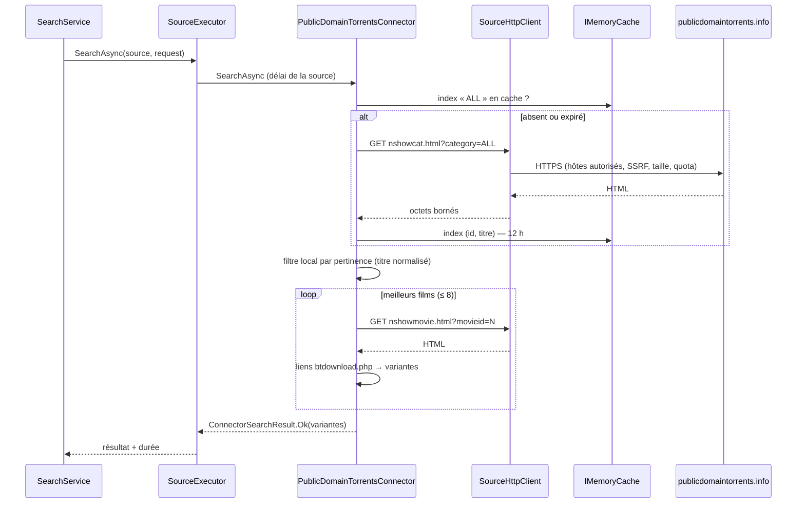

# 2. Concevoir le connecteur

## 2.1 Où se place le connecteur

```
TorrentSearch.Infrastructure/
└── Connectors/
    ├── ConnectorBase.cs                    ← classe de base (erreurs → résultats structurés, contrôle de santé)
    ├── InternetArchiveConnector.cs
    ├── StaticCatalogConnector.cs
    ├── AcademicTorrentsConnector.cs
    └── PublicDomainTorrentsConnector.cs    ← nouveau
```

Le connecteur ne connaît ni EF Core, ni la base, ni l'interface. Il dépend de `SourceHttpClient` (et, ici, d'`IMemoryCache`).
Le reste (enregistrement, rattachement aux films, déduplication, classement, cache par requête, historique, interface) est déjà
géré par l'application.



## 2.2 Cartographie des données

| Champ `ReleaseCandidate` | Origine | Règle |
|---|---|---|
| `ExternalId` | `{movieid}:{nom du fichier .torrent}` | stable, unique par source (clé d'upsert) |
| `ReleaseName` | `"{titre} — {libellé du lien}"` (ex. « A Bucket of Blood — Divx 716MB AVI ») | libellé nettoyé du préfixe « Click for » |
| `WorkTitle` | titre du film (lien de l'index ou `<title>` de la page) | sert au regroupement par film |
| `Year` | — | **`null`** (non fourni) |
| `SizeBytes` | « 716MB », « 182 MB » dans le libellé | `Mo × 1 048 576`, sinon `null` ; taille **annoncée**, non vérifiée |
| `Codec` | « Divx » → `DivX` ; « Xvid » → `XviD` | sinon `null` (MP4 = conteneur, pas un codec) |
| `Quality` | — | `null` |
| `Resolution` | — | `null` |
| `TorrentUrl` | `href` du lien `btdownload.php` | réécrit en **HTTPS** ; hôte `www.publicdomaintorrents.com` exigé |
| `MagnetUri`, `InfoHash` | — | `null` ; l'info-hash est calculé lors de la récupération du `.torrent` (l'application construit alors le magnet) |
| `DetailsUrl` | `https://www.publicdomaintorrents.info/nshowmovie.html?movieid={n}` | |
| `Licence` | — | `"Domaine public (déclaré par la source, non vérifié)"` |
| `Seeders`, `Leechers` | — | `null` (jamais 0 par défaut) |
| `Languages` | — | `null` |

## 2.3 Capacités déclarées

```csharp
SourceCapabilities.Search | SourceCapabilities.TorrentFile | SourceCapabilities.Size | SourceCapabilities.Licence
```

Non déclarées : `Pagination` (index complet filtré localement), `Magnet` et `InfoHash` (absents des pages), `Seeders`,
`PublicationDate`, `CatalogSync` (aucun mécanisme prévu par la source pour une indexation incrémentale).

## 2.4 Stratégie d'accès et de sobriété

| Décision | Valeur | Raison |
|---|---|---|
| Index des titres | `nshowcat.html?category=ALL`, mis en cache **12 h** en mémoire | une seule grosse requête au lieu d'une par recherche |
| Pages film par recherche | **8 au maximum**, les plus pertinentes | borne le nombre de requêtes (et la durée) |
| Seuil de pertinence | `TitleNormalizer.Relevance ≥ 0.5` | évite d'interroger des films sans rapport |
| Quota par défaut | 6 requêtes/min | site amateur sans API : prudence |
| Délai par défaut | 20 s | index potentiellement volumineux |
| Taille max index | 4 Mo (`MaxSearchResponseBytes`) | au-delà : `ResponseTooLarge` (source signalée) |
| Contrôle de santé | `nshowcat.html?category=horror` (≈ 6 Ko) + vérification qu'au moins 5 liens `nshowmovie.html?movieid=` existent | une page légère, et une dérive de format rend la source « Suspecte » |
| Intervalle de contrôle | 24 h | source peu volatile |

> **Quota local et pages film** : avec 6 requêtes/min, une recherche « froide » (index + 8 pages) peut dépasser le quota ;
> `SourceHttpClient` attend alors dans la limite du délai de la source, puis renvoie `RateLimited`. Le connecteur renvoie dans ce cas
> les variantes déjà collectées avec un avertissement (résultat partiel), plutôt qu'un échec complet.

## 2.5 Hôtes autorisés et transport

```
www.publicdomaintorrents.info, www.publicdomaintorrents.com
```

- Les liens sont publiés en `http://` : on remplace le schéma par `https` **puis** on vérifie l'hôte (`HostPolicy`). On ne relâche
  jamais l'exigence HTTPS du client réseau pour cette source.
- Pas de joker `*.publicdomaintorrents.com` : `ads.publicdomaintorrents.com` (publicité) doit rester interdit.
- Une redirection vers un autre hôte → `SuspiciousRedirect` (géré par `SourceHttpClient`).

## 2.6 Analyse HTML : regex ou bibliothèque ?

| Option | Avantages | Inconvénients |
|---|---|---|
| `[GeneratedRegex]` ciblées (choix retenu) | aucune dépendance, rapide, suffisant pour 2 motifs très réguliers (`nshowmovie.html?movieid=N>Titre<` et `href=…btdownload.php…>Libellé<`) | fragile si le site change de balisage → compensé par le contrôle de santé et les tests sur fixtures |
| AngleSharp (DOM HTML5) | robuste aux variations de balisage | dépendance supplémentaire (~1 Mo) à justifier ; inutile tant que les motifs restent stables |

Le cahier des charges impose de justifier toute dépendance : on commence sans, et on bascule sur AngleSharp si le site évolue.
Dans les deux cas : **ne jamais exécuter de script**, ignorer iframes/publicités, décoder les entités HTML (`WebUtility.HtmlDecode`).

## 2.7 Erreurs : correspondance avec `SourceErrorCode`

| Situation | Code | Statut de santé |
|---|---|---|
| DNS/connexion impossible, HTTP 5xx, 404 | `SourceUnavailable` | Indisponible |
| Délai dépassé | `Timeout` | Indisponible |
| HTTP 401/403 | `AccessDenied` | Indisponible |
| HTTP 429 ou quota local | `RateLimited` | Dégradée (`Retry-After` respecté) |
| Page HTML sans aucun lien film (structure changée, page de vérification) | `MalformedResponse` | **Suspecte** |
| Redirection hors des deux hôtes, TLS invalide | `SuspiciousRedirect` / `TlsError` | **Suspecte** (récupération de `.torrent` bloquée) |
| Index > 4 Mo | `ResponseTooLarge` | Indisponible |
| Exception inattendue dans le connecteur | `InternalError` (via `SourceExecutor`) | Indisponible |
