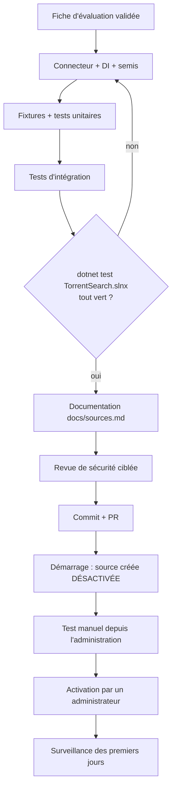

# 5. Intégrer et livrer

## 5.1 Ordre des opérations



## 5.2 Base de données

Aucune migration : ajouter une source = une ligne `sources` créée par le semis au démarrage. Une migration n'est nécessaire
que si le connecteur exige un **nouveau champ** commun à toutes les sources (rare). Dans ce cas :

```powershell
dotnet ef migrations add AjoutChampX --project src\TorrentSearch.Infrastructure --startup-project src\TorrentSearch.Infrastructure --output-dir Persistence\Migrations
dotnet test tests\TorrentSearch.Tests.Integration   # DatabaseMigrationTests valide la migration sur base neuve
```

N'ajoutez jamais de colonne spécifique à une source dans `search_results` : si une information n'entre dans aucun champ
existant, elle n'est probablement pas nécessaire à l'affichage ou au classement.

## 5.3 Documentation à mettre à jour dans le dépôt

| Fichier | Contenu à ajouter |
|---|---|
| `docs/sources.md` | une section « Sources intégrées » complète (tableau de la fiche d'évaluation, hôtes autorisés, capacités, limites, réglages par défaut) ; retirer la ligne de la table « non intégrées » |
| `docs/research/sources-evaluation.md` | les observations brutes (dates, URL, statuts HTTP) |
| `README.md` | la ligne du tableau « Sources activées » (état par défaut : désactivée) |
| `docs/testing.md` | les nouveaux tests dans les tables de couverture |
| `docs/progress.md` | l'ajout, les tests exécutés, les points nécessitant une intervention humaine (activation) |
| `docs/decisions/` | un ADR si un choix structurant a été fait (ex. extraction HTML sans dépendance) |

Exemple de section pour `docs/sources.md` :

```markdown
### 4. Public Domain Torrents (désactivée par défaut)

| | |
|---|---|
| URL officielle | <https://www.publicdomaintorrents.info> (pages), <https://www.publicdomaintorrents.com> (.torrent) |
| Type | Site de diffusion de films classiques (pages HTML statiques) |
| Contenus autorisés | Films anciens présentés comme du domaine public ; **licence non fournie par œuvre** (déclarée par le site, non vérifiée) |
| Conditions | aucune page de conditions trouvée ; `robots.txt` sans restriction (28/10/2026) |
| Accès | index `nshowcat.html?category=ALL` (cache 12 h) ; pages `nshowmovie.html?movieid={n}` ; liens `bt/btdownload.php?type=torrent&file=…` réécrits en HTTPS |
| Hôtes autorisés | `www.publicdomaintorrents.info`, `www.publicdomaintorrents.com` |
| Capacités | Search, TorrentFile, Size, Licence |
| Limites | extraction HTML ; pas d'année, de langue, de résolution, de seeders, de magnet avant récupération ; ≤ 8 pages film par recherche ; tailles annoncées non vérifiées |
| Réglages par défaut | priorité 30, 6 requêtes/min, délai 20 s, contrôle toutes les 24 h |
```

## 5.4 Revue de sécurité ciblée

À faire relire par une seconde personne (ou l'agent sécurité) avant fusion :

| Point | Vérification |
|---|---|
| Requêtes sortantes | uniquement via `Http.GetAsync` ; aucune instanciation de `HttpClient` dans le connecteur |
| Hôtes | liste exacte, pas de joker inutile, aucun hôte tiers |
| Transport | aucun assouplissement de HTTPS ; réécriture `http→https` **avant** le contrôle d'hôte |
| Entrées | termes de recherche jamais concaténés dans une URL sans encodage (ici : aucun terme envoyé au site, filtrage local) |
| Analyse | regex avec délai d'exécution ; tailles bornées ; entités HTML décodées ; aucun script exécuté |
| Données | aucune valeur inventée ; licence explicitement « non vérifiée » |
| Erreurs | pas d'exception non classée qui sortirait du connecteur (sinon `InternalError` générique) |
| Journaux | pas de journalisation du contenu des pages ni d'URL contenant des secrets |
| Sobriété | cache de l'index, borne de pages, quota par défaut prudent |

## 5.5 Commit et PR

Un seul commit cohérent (ou une PR) contenant connecteur, enregistrement, semis, fixtures, tests et documentation. Exemple de
message :

```
Ajoute le connecteur Public Domain Torrents (désactivé par défaut)

- extraction HTML de l'index et des pages film, liens .torrent réécrits en HTTPS
- capacités : recherche, .torrent, taille, licence déclarée (non vérifiée)
- fixtures réelles du 28/10/2026, tests unitaires et d'intégration
- docs/sources.md, README, testing.md, progress.md
```

## 5.6 Activation progressive

1. Démarrage → la source apparaît **désactivée** dans l'administration, avec ses limites.
2. « Tester » → vérifier le statut et les avertissements.
3. Activer, puis faire 2 ou 3 recherches et une récupération de `.torrent`.
4. Surveiller pendant quelques jours : historique de santé, erreurs récentes, temps de réponse.
5. Ajuster délai, quota et cache **depuis l'administration** si nécessaire (aucun redéploiement).
